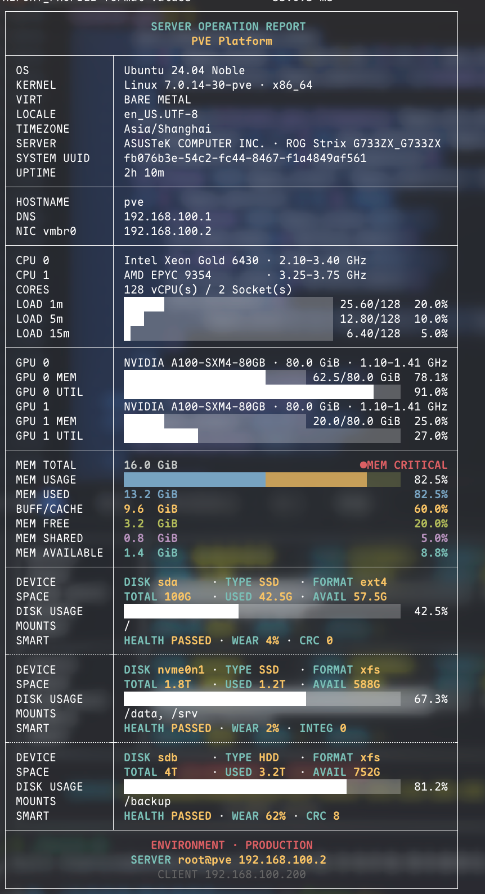

# machine_report.sh

English | [简体中文](README_ZH.md)

Inspect server status from your terminal. A single run reports the operating
system, CPU and load, GPU, memory, disks and SMART health, network interfaces,
DNS, and NTP synchronization status, server, and clock offset. Missing tools
or insufficient permissions degrade individual fields without interrupting
the report.

Works on Linux and macOS. The report is a single-file Bash script and requires
Bash 3.2+, awk, and Perl 5. For GPU and SMART data, install `nvidia-smi` and
`smartmontools`.



## Quick Start

```bash
bash <(curl -fsSL https://raw.githubusercontent.com/SJFCS/machine_report.sh/main/install.sh)
mreport
```

After installation, a new interactive bash/zsh session displays the report
once; `mreport` can be run manually at any time. To install the command without
automatic startup:

```bash
bash <(curl -fsSL https://raw.githubusercontent.com/SJFCS/machine_report.sh/main/install.sh) --no-autostart
```

You can also run the report directly from source:

```bash
git clone https://github.com/SJFCS/machine_report.sh.git
cd machine_report.sh
./machine_report.sh
```

## Configuration

Configuration is provided through environment variables. Boolean switches
accept `0/1`, `true/false`, `yes/no`, and `on/off`.

| Variable | Default | Description |
| --- | --- | --- |
| `REPORT_MOCK_ENABLED` | `0` | Set to `1` to use built-in demo GPU, disk, and scalar data |
| `REPORT_PROFILE` | `0` | Set to `1` to write stage timings to stderr |
| `REPORT_GPU_ENABLED` | `1` | Set to `0` to skip GPU collection |
| `REPORT_GPU_TIMEOUT` | `1` | Timeout in seconds for one `nvidia-smi` call; `0` disables the limit |
| `REPORT_SMART_ENABLED` | `1` | Set to `0` to skip SMART collection |
| `REPORT_SMART_TIMEOUT` | `2` | SMART timeout in seconds per disk; `0` disables the limit |
| `REPORT_NTP_ENABLED` | `1` | Set to `0` to skip NTP collection |
| `REPORT_NTP_TIMEOUT` | `1` | macOS `sntp` query timeout in seconds; `0` disables the limit |
| `NO_COLOR` | Unset | Disable ANSI colors when set |
| `FORCE_COLOR` | Unset | Keep colors even when output is piped |
| `REPORT_TITLE` | `SERVER OPERATION REPORT` | Cover title; set to an empty string to hide it |
| `REPORT_SUBTITLE` | `PVE Platform` | Cover subtitle; set to an empty string to hide it |
| `REPORT_ENVIRONMENT` | `PRODUCTION` | Footer environment label |

Common examples:

```bash
REPORT_MOCK_ENABLED=1 mreport        # use built-in demo data
REPORT_GPU_ENABLED=0 mreport         # skip GPU queries
REPORT_NTP_ENABLED=0 mreport         # skip NTP synchronization queries
NO_COLOR=1 mreport                   # disable ANSI colors
REPORT_PROFILE=1 mreport             # show stage timings
```

## Installation

### Current User

```bash
bash <(curl -fsSL https://raw.githubusercontent.com/SJFCS/machine_report.sh/main/install.sh)
```

No root access is required. The report is installed under
`~/.local/share/machine_report/`, the command is `~/.local/bin/mreport`, and
startup configuration is written to `~/.bashrc` and `~/.zshrc`.

### All Users

```bash
sudo bash <(curl -fsSL https://raw.githubusercontent.com/SJFCS/machine_report.sh/main/install.sh) --system
```

Root access is required. The report is installed under
`/usr/local/lib/machine_report/`, the command is `/usr/local/bin/mreport`, and
startup configuration is written to `/etc/profile`.

## Uninstall

```bash
# Current user
bash <(curl -fsSL https://raw.githubusercontent.com/SJFCS/machine_report.sh/main/install.sh) --uninstall

# All users
sudo bash <(curl -fsSL https://raw.githubusercontent.com/SJFCS/machine_report.sh/main/install.sh) --system --uninstall
```

## Dependencies

Required at runtime:

| Dependency | Requirement | Purpose |
| --- | --- | --- |
| Bash | 3.2+ | Runs the report; also required when the login shell is zsh |
| awk | POSIX awk | Parses GPU, disk, and memory output |
| Perl | 5 | Calculates UTF-8/ANSI display widths and renders the table |
| Basic tools | `sed`, `tr`, `date`, `uname`, `hostname`, `who`, `df`, and similar | Used for system information collection and installation |

Complete Linux collection also relies on `/proc`, `/sys`, util-linux, iproute2,
and coreutils. macOS works with the default system environment; Apple Silicon
GPU utilization and unified-memory usage are read through built-in `ioreg`
statistics. Apple Silicon CPU frequency shows P/E groups with vCPU counts and
DVFS ranges from `ioreg`; the live clock is not exposed without elevated
privileges. On Linux hybrid CPUs, each cpufreq min/max group is shown with its
vCPU count and threads per core when `lscpu -e` exposes them. Frequency tiers
follow a `SUM CORES` row and global load averages, grouped under each
`CPU Socket`.

Recommended for complete collection:

| Dependency | Provided data | When missing |
| --- | --- | --- |
| `nvidia-smi` | NVIDIA GPU model, memory, and utilization | Shows `GPU -` |
| `smartctl` (`smartmontools`) | Disk SMART health, wear, and error counters | Shows `N/A` |

Other optional tools degrade individual fields when missing:

| Tool | Provided data | When missing |
| --- | --- | --- |
| `lsblk` | Linux physical disks, partitions, and mount points | No physical disk rows |
| `ip` | IPv4 interfaces and primary IP | No network interface rows |
| `lscpu` | Linux CPU model and frequency | Falls back to `/proc/cpuinfo` |
| `dmidecode` | DMI vendor, model, and UUID | Shows `UNKNOWN`; usually requires root |
| `systemd-detect-virt` | Virtualization type | Falls back to DMI information |
| `timedatectl` | IANA time zone name | Falls back to `/etc/timezone` or `/etc/localtime` |
| `resolvectl` | Upstream DNS servers | Falls back to `/etc/resolv.conf` |
| `chronyc` / `timedatectl` / `ntpq` / `ntpstat` | Linux NTP status, server, and offset | Uses the next available NTP tool |
| `sntp` | macOS clock offset and resolved server address | Status/server come from `systemsetup` when available; offset shows `-` |

Install dependencies by distribution:

```bash
# Debian / Ubuntu
sudo apt update
sudo apt install bash gawk perl util-linux iproute2 coreutils curl smartmontools

# Fedora / RHEL
sudo dnf install bash gawk perl util-linux iproute coreutils curl smartmontools

# Arch Linux
sudo pacman -S bash gawk perl util-linux iproute2 coreutils curl smartmontools

# macOS (Bash, awk, and Perl are included with the system)
brew install bash smartmontools
```

`nvidia-smi` is provided by the NVIDIA driver; the driver package name depends
on the distribution and GPU model. Remote installation requires `curl` or
`wget`.

### SMART Fields

```text
SMART │ HEALTH PASSED · WEAR 4% · INTEG 0
SMART │ HEALTH PASSED · WEAR 4% · CRC 0
```

| Field | Meaning |
| --- | --- |
| `HEALTH` | Vendor health self-assessment; `PASSED`/`OK` is healthy, `FAILED` indicates a possible failure |
| `WEAR` | Percentage of rated life consumed; lower is better; HDDs usually show `-` |
| `INTEG` | NVMe media/data integrity error count; `0` is normal |
| `CRC` | SATA/SAS link CRC error count; `0` is normal |

`N/A` or `-` usually means the metric is unavailable because of missing
permissions or tools, a disk in standby, or a device that does not expose it.
It does not necessarily indicate a disk failure. Reading SMART on Linux usually
requires root; USB enclosures and virtual disks may not provide SMART data.

### NTP Fields

```text
NTP STATUS │ ●SYNCED
NTP SERVER │ time.cloudflare.com (162.159.200.1)
NTP OFFSET │ +0.284 ms
```

| Field | Meaning |
| --- | --- |
| `STATUS` | `SYNCED` means the time service reports a valid synchronization; `UNSYNCED` means it is running but not synchronized; `DISABLED` means collection is turned off; `UNKNOWN` means no supported tool could determine the state |
| `SERVER` | Active or configured NTP server; `-` when it was not reported |
| `OFFSET` | Clock difference reported by the active NTP tool, converted to milliseconds; the sign convention follows that tool; `-` when unavailable |

Linux uses the first available source that returns usable data from `chronyc`,
`timedatectl`, `ntpq`, and `ntpstat`, then falls back to configuration files
and the `timedatectl` synchronization flag. macOS reads `systemsetup` when
accessible and uses `sntp` for the offset. NTP details degrade independently
and never interrupt the rest of the report.

## FAQ

**The report is slow.** Run `REPORT_PROFILE=1 mreport >/dev/null` to inspect
stage timings. GPU or SMART probing is usually responsible; set
`REPORT_GPU_ENABLED=0` or `REPORT_SMART_ENABLED=0` to skip them.

**Fields show `N/A`, `-`, or `UNKNOWN`.** The corresponding tool is missing,
permissions are insufficient, or the platform does not provide the data. The
report continues to render normally.

**NTP status is `UNKNOWN`, `UNSYNCED`, or `DISABLED`.** `DISABLED` means
`REPORT_NTP_ENABLED=0`. `UNKNOWN` means no supported time-sync tool returned a
usable answer. `UNSYNCED` means the tool responded but the clock has no valid
synchronization; check the time service, upstream server, and network. On
macOS, the offset also requires `sntp` and an allowed NTP query.

## Development

Source fragments live in `src/`. `machine_report.sh` is a build artifact and
should not be edited directly:

```text
src/core/       Display widths, numbers, tables, layout, rendering, and mr_* API
src/sources/    System, platform, GPU, and disk data collection
src/handlers/   Presentation logic for each report section
src/main.sh     Collect -> handlers -> measure -> fill -> render
build.sh        Merge source files and generate machine_report.sh
```

Build and verify after making changes:

```bash
./build.sh
bash -n machine_report.sh
REPORT_MOCK_ENABLED=1 ./machine_report.sh
```

See the [development guide](docs/DEVELOPMENT.md) for handler conventions, the
`mr_*` API, and testing requirements. Issues and pull requests are welcome;
include the reproduction command, platform details, and relevant
`REPORT_PROFILE=1` output when reporting a problem.
