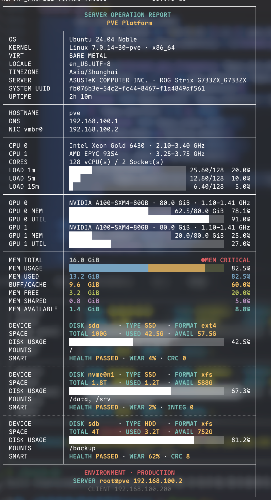

# machine_report.sh

[English](README.md) | 简体中文

在终端快速查看服务器运行状态。一次运行输出系统、CPU/负载、GPU、内存、
磁盘/SMART、网络和 DNS；工具缺失或权限不足时自动降级，不会中断报告。

适用于 Linux 和 macOS。它是单文件 Bash 脚本，依赖 Bash 3.2+、awk 和
Perl 5；GPU/SMART 采集建议安装 `nvidia-smi` 和 `smartmontools`。



## 快速开始

```bash
bash <(curl -fsSL https://raw.githubusercontent.com/SJFCS/machine_report.sh/main/install.sh)
mreport
```

安装后，新开的交互式 bash/zsh 会自动展示一次报告；`mreport` 可以随时
手动执行。只想安装命令、不要自动展示：

```bash
bash <(curl -fsSL https://raw.githubusercontent.com/SJFCS/machine_report.sh/main/install.sh) --no-autostart
```

也可以不安装，直接从源码运行：

```bash
git clone https://github.com/SJFCS/machine_report.sh.git
cd machine_report.sh
./machine_report.sh
```

## 配置

配置通过环境变量传入。开关变量支持 `0/1`，也支持
`true/false`、`yes/no`、`on/off`。

| 变量                   | 默认值                    | 说明                                       |
| ---------------------- | ------------------------- | ------------------------------------------ |
| `REPORT_MOCK_ENABLED`  | `0`                       | 设为 `1` 使用内置 GPU、磁盘和标量演示数据  |
| `REPORT_PROFILE`       | `0`                       | 设为 `1` 将各阶段耗时写入 stderr           |
| `REPORT_GPU_ENABLED`   | `1`                       | 设为 `0` 跳过 NVIDIA GPU 采集              |
| `REPORT_GPU_TIMEOUT`   | `1`                       | 单次 `nvidia-smi` 超时秒数；`0` 表示不限时 |
| `REPORT_SMART_ENABLED` | `1`                       | 设为 `0` 跳过 SMART 采集                   |
| `REPORT_SMART_TIMEOUT` | `2`                       | 单块磁盘 SMART 超时秒数；`0` 表示不限时    |
| `NO_COLOR`             | 未设置                    | 设置后关闭颜色                             |
| `FORCE_COLOR`          | 未设置                    | 设置后即使输出到管道也保留颜色             |
| `REPORT_TITLE`         | `SERVER OPERATION REPORT` | 封面标题；传空串可隐藏                     |
| `REPORT_SUBTITLE`      | `PVE Platform`            | 封面副标题；传空串可隐藏                   |
| `REPORT_ENVIRONMENT`   | `PRODUCTION`              | 页脚环境标签                               |

```bash
REPORT_MOCK_ENABLED=1 mreport        # 使用内置演示数据
REPORT_GPU_ENABLED=0 mreport         # 跳过 NVIDIA GPU 查询
NO_COLOR=1 mreport                   # 关闭 ANSI 颜色
REPORT_PROFILE=1 mreport             # 查看各阶段耗时
```

## 安装

### 当前用户

```bash
bash <(curl -fsSL https://raw.githubusercontent.com/SJFCS/machine_report.sh/main/install.sh)
```

不需要 root。报告安装到 `~/.local/share/machine_report/`，命令为
`~/.local/bin/mreport`，启动配置写入 `~/.bashrc` 和 `~/.zshrc`。

### 所有用户

```bash
sudo bash <(curl -fsSL https://raw.githubusercontent.com/SJFCS/machine_report.sh/main/install.sh) --system
```

需要 root。报告安装到 `/usr/local/lib/machine_report/`，命令为
`/usr/local/bin/mreport`，启动配置写入 `/etc/profile`。

## 卸载

```bash
# 当前用户
bash <(curl -fsSL https://raw.githubusercontent.com/SJFCS/machine_report.sh/main/install.sh) --uninstall

# 所有用户
sudo bash <(curl -fsSL https://raw.githubusercontent.com/SJFCS/machine_report.sh/main/install.sh) --system --uninstall
```

## 依赖

运行时必需：

| 依赖     | 要求                                                     | 用途                                      |
| -------- | -------------------------------------------------------- | ----------------------------------------- |
| Bash     | 3.2+                                                     | 执行报告；登录 shell 是 zsh 时也需要 Bash |
| awk      | POSIX awk                                                | GPU、磁盘和内存文本解析                   |
| Perl     | 5                                                        | UTF-8/ANSI 显示宽度计算和表格渲染         |
| 基础工具 | `sed`、`tr`、`date`、`uname`、`hostname`、`who`、`df` 等 | 系统信息采集和安装                        |

Linux 完整采集还依赖 `/proc`、`/sys`、util-linux、iproute2 和 coreutils。
macOS 默认环境即可运行，Apple Silicon 的 GPU 信息由系统内置工具读取。

完整采集建议安装：

| 依赖                          | 提供的数据                      | 缺失时       |
| ----------------------------- | ------------------------------- | ------------ |
| `nvidia-smi`                  | NVIDIA GPU 型号、显存和利用率   | 显示 `GPU -` |
| `smartctl`（`smartmontools`） | 磁盘 SMART 健康、磨损和错误计数 | 显示 `N/A`   |

其他可选工具缺失时，对应字段也会降级显示：

| 工具                  | 提供的数据                   | 缺失时                                   |
| --------------------- | ---------------------------- | ---------------------------------------- |
| `lsblk`               | Linux 物理磁盘、分区和挂载点 | 不输出物理磁盘行                         |
| `ip`                  | IPv4 网卡和主 IP             | 不输出网卡行                             |
| `lscpu`               | Linux CPU 型号和频率         | 回退读取 `/proc/cpuinfo`                 |
| `dmidecode`           | DMI 厂商、型号和 UUID        | 对应字段显示 `UNKNOWN`，通常需要 root    |
| `systemd-detect-virt` | 虚拟化类型                   | 回退 DMI 信息                            |
| `timedatectl`         | IANA 时区名称                | 回退 `/etc/timezone` 或 `/etc/localtime` |
| `resolvectl`          | 上游 DNS                     | 回退读取 `/etc/resolv.conf`              |

常见发行版安装：

```bash
# Debian / Ubuntu
sudo apt update
sudo apt install bash gawk perl util-linux iproute2 coreutils curl smartmontools

# Fedora / RHEL
sudo dnf install bash gawk perl util-linux iproute coreutils curl smartmontools

# Arch Linux
sudo pacman -S bash gawk perl util-linux iproute2 coreutils curl smartmontools

# macOS（Bash、awk、Perl 已随系统提供）
brew install bash smartmontools
```

`nvidia-smi` 随 NVIDIA 驱动提供；驱动包名称取决于发行版和显卡型号。
远程安装需要 `curl` 或 `wget`。

### SMART 字段

```text
SMART │ HEALTH PASSED · WEAR 4% · INTEG 0
SMART │ HEALTH PASSED · WEAR 4% · CRC 0
```

| 字段     | 含义                                                        |
| -------- | ----------------------------------------------------------- |
| `HEALTH` | 厂商健康自检结果；`PASSED`/`OK` 正常，`FAILED` 表示可能故障 |
| `WEAR`   | 已消耗寿命百分比，越低越好；HDD 通常显示 `-`                |
| `INTEG`  | NVMe 介质/数据完整性错误数，`0` 为正常                      |
| `CRC`    | SATA/SAS 链路 CRC 错误数，`0` 为正常                        |

显示 `N/A` 或 `-` 通常表示没有读取权限、工具缺失、磁盘待机或设备不
暴露该指标，不代表磁盘一定故障。Linux 读取 SMART 通常需要 root；
USB 转接盒和虚拟磁盘也可能不提供 SMART 数据。

## 常见问题

**运行很慢**：先用 `REPORT_PROFILE=1 mreport >/dev/null` 查看阶段耗时。
通常是 GPU 或 SMART 探测；可分别设置 `REPORT_GPU_ENABLED=0`、
`REPORT_SMART_ENABLED=0` 跳过。

**字段显示 `N/A`、`-` 或 `UNKNOWN`**：对应工具缺失、权限不足，或平台
不提供该数据。报告会继续渲染，不需要额外处理。

## 开发

源码片段位于 `src/`，`machine_report.sh` 是构建产物，不要直接修改：

```text
src/core/       宽度、数值、表格、布局、渲染和 mr_* API
src/sources/    系统、平台、GPU、磁盘等数据采集
src/handlers/   各报告区块的展示逻辑
src/main.sh     采集 → handler → 测量 → 回填 → 渲染
build.sh        合并源码并生成 machine_report.sh
```

修改后构建并验证：

```bash
./build.sh
bash -n machine_report.sh
REPORT_MOCK_ENABLED=1 ./machine_report.sh
```

新增或修改 handler、`mr_*` API 和测试约定见
[开发文档](docs/DEVELOPMENT.md)。欢迎提交 Issue 和 PR；修复问题时请
附上复现命令、平台信息，以及 `REPORT_PROFILE=1` 的相关输出。
